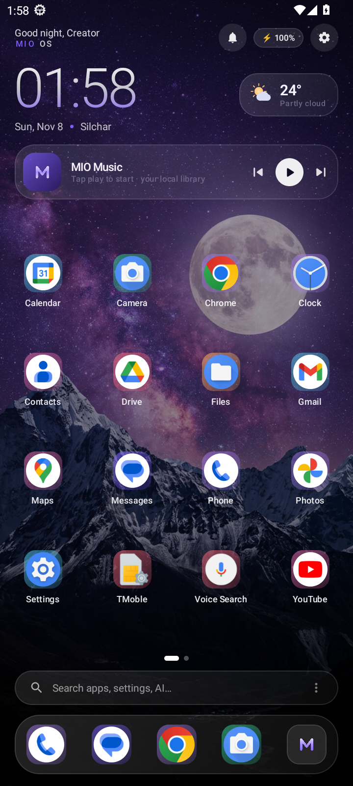

# SEGAWA OS v2.0 (Sakura) — a real Android launcher by RJNX

SEGAWA OS is a **working Android home-screen launcher** written in Kotlin + Jetpack Compose.
Install the APK, choose SEGAWA OS as your Home app, and pressing the Home key/gesture opens it —
including after a reboot. It is not a mockup, a website or a Figma file.



**Verified by CI on an Android 13 emulator shaped like a Galaxy A03 (720×1600 @ 270 dpi, 2 GB RAM cap):
see [`ci/emulator-report.txt`](ci/emulator-report.txt) and the screenshots in [`ci/shots/`](ci/shots).
JVM unit tests (53 cases over the pure core modules) gate every build, and the emulator run
installs the APK, sets it as the default home app, presses the Home key, exercises the screens,
reboots the device and checks for crashes.**

| Check | Result |
|---|---|
| APK installs on Android 13 | ✅ `Success` |
| Home intent filter (`MAIN` + `CATEGORY_HOME`) registered | ✅ |
| SEGAWA OS resolves as the **default launcher** | ✅ after `set-home-activity` |
| HOME key is actually **routed** to SEGAWA OS | ✅ |
| **HOME key** returns to SEGAWA OS from another app | ✅ |
| Drawer, search, control centre, torch toggle | ✅ |
| Settings / AI / Music / Browser / Automation / Backup / Store / Themes / Files / Gallery / Notes / Calendar / Clock / Calculator / Weather / Gaming / Lock / About | ✅ |
| Playback reaches a `MediaSession` (lock-screen controls) | ✅ |
| 500 random monkey events without dying | ✅ |
| **Default launcher survives `adb reboot`** | ✅ |
| **R8-minified release APK** installs, is the default home app, answers HOME | ✅ |
| No `FATAL EXCEPTION` in logcat | ✅ |

Build sizes: debug ~19 MB, release **~2.8 MB** (R8 + resource shrinking).

---

## 1. Install & activate (2 minutes)

1. **Download the APK**
   - GitHub Release (recommended): <https://github.com/devkazzu/SEGawaOS/releases/latest>
   - Direct from this branch: [`dist/SEGAWA-OS-debug.apk`](dist/SEGAWA-OS-debug.apk) ·
     [`dist/SEGAWA-OS-release.apk`](dist/SEGAWA-OS-release.apk)
2. On the phone, allow installs from your browser/file manager when Android asks
   (*Install unknown apps*).
3. Open **SEGAWA OS** → the welcome flow starts:
   - **Get started** → **Set as default**
   - Android's own *RoleManager* dialog appears ("Use SEGAWA OS as Home app?") or the
     *Default apps ▸ Home app* screen on Android 9 and older.
   - Pick **SEGAWA OS**, then **Always / Set as default**.
4. Press the Home button — SEGAWA OS is now your home screen.
   You can re-check any time in **Settings ▸ Home screen** or from the welcome flow.

> Minimum Android 8.0 (API 26). `applicationId` is `com.mio.os` (release) and
> `com.mio.os.debug` (debug build) — install only one. Internal IDs (`com.mio.os`,
> `mio_prefs_v1`) are kept so v1.x installs upgrade in place.

---

## 2. What's new in 2.0

- **Arrange mode** — drag-to-reorder home grid with auto-scroll and persisted order
- **Icon Studio** — 5 profiles (shape/scale/glow) + per-app custom images via system picker
- **Wallpaper studio** — favorites, history, timed rotation (15+ min), live gradient/petal
  engines and video wallpapers through a real `WallpaperService`
- **Universal search** — one box over apps, notes, music, wallpapers and settings
- **4 home-screen widgets** — Clock, Search, Music (live track + transport), Battery;
  pinnable from the drawer with one tap (any launcher can host them)
- **Notes 2.0** — titles, categories, tags, favorites, search, on-device summaries
- **Music 2.0** — playlists, `.lrc` synced lyrics, sleep timer, working favorites
- **SEGAWA Browser** — WebView browser with smart address bar, bookmarks, history,
  selectable search engine
- **Automation** — time-based routines (reminder, focus/DND, music, wallpaper, app
  launch) with day picker, run-now test and reboot re-arming
- **Backup & restore** — everything into one JSON file via the system picker,
  optionally AES-256-GCM encrypted
- **Theme store** — honest on-device collection: 8 themes apply instantly, no accounts
- **Segawa AI 2.0** — chat threads, on-device memory ("my bike is red"),
  20+ device commands, voice replies (TTS) + voice input, on-device/cloud badges
- **Control Center studio** — editable tiles, recent-apps row
- **About 2.0** — on-device screen-time dashboard (opt-in Usage Access)
- **53 JVM unit tests** gating every CI build; unused `RECORD_AUDIO` permission removed

See [`CHANGELOG.md`](CHANGELOG.md) for the full list.

---

## 3. What actually works

### Home screen (`ui/home/HomeScreen.kt`)
- Big gradient digital clock + date + city, live weather pill (Open-Meteo, no API key)
- Always-present music widget (artwork, title, prev/play/next)
- Multi-page app grid, swipe up for the drawer, swipe down for the control centre
- Dock with auto-detected Phone/Messages/Browser/Camera (or your own picks)
- Search pill, per-app notification badges, page indicator, persisted custom order
- Double-tap gesture (search / drawer / control centre / AI / lock — your choice)
- **App folders** — long-press any app → *Move to folder* → create/rename/delete
- Long-press the wallpaper for the home customisation sheet
- App quick sheet: open, app info, hide, uninstall, move to folder, favorite, dock, custom icon

### App drawer (`ui/drawer/AppDrawer.kt`)
- Every installed launchable activity, real icons and names (PackageManager)
- Live search, category chips (Games/Music/Video/Photos/Social/Work…), favorites filter
- Sorting: alphabetical / most-recent / category
- Widgets tab: SEGAWA widget toggles + one-tap widget pinning
- Hidden-apps management, per-app context sheet (favorite, dock, custom icon)

### Control centre (`ui/control/ControlCenter.kt`)
| Tile | Behaviour |
|---|---|
| Wi-Fi / Bluetooth / Internet | Opens the Android system panel (`Settings.Panel`) |
| Torch | **Real** `CameraManager.setTorchMode` |
| Do Not Disturb | **Real** `NotificationManager.setInterruptionFilter` (needs DND access) |
| Night | **Real** `UiModeManager.setApplicationNightMode` (API 31+) |
| Brightness | Changes SEGAWA's own window instantly; the system brightness is written when *Modify system settings* is granted |
| Volume | **Real** `AudioManager.setStreamVolume` with the system volume UI |
| Airplane / Rotate / Cast / Hotspot / Battery | Open the matching Android settings screen — a normal app cannot flip these |
| Lock | `DevicePolicyManager.lockNow` when the optional device admin is enabled, otherwise the SEGAWA lock screen |

Round tiles are editable (Edit mode) and a recent-apps row sits above the quick jumps.

### Segawa AI (`ui/apps/AiScreen.kt`, `core/AiEngine.kt`)
- Offline assistant that **acts on the device**: "open camera", "open themes",
  "torch on", "volume 40", "next song", "dnd on", "note buy milk", "play music",
  "use cyberpunk theme", "next wallpaper", "am I the default launcher?"
- Chat threads, on-device memory and facts, per-message on-device/cloud badges
- Voice input (system recogniser) and voice replies (system TTS)
- Plug any OpenAI-compatible endpoint + key + model in the AI settings sheet
  (stored only on the device) to switch to full conversation

### Music (`ui/apps/MusicScreen.kt`, `core/MioPlayer.kt`, `service/MusicService.kt`)
- Local library from MediaStore, album art, seek bar, queue, playlists
- `.lrc` synced lyrics (user-picked sidecar files), sleep timer, favorites
- Foreground playback service with a media notification, platform `MediaSession`
  metadata and **lock-screen controls**
- Real equalizer through `android.media.audiofx.Equalizer`
- Ships a synthesised ambient demo track so playback works on a device with no music

### Other apps
Browser (WebView + bookmarks/history), Automation (routines), Backup & restore,
Theme store, Universal search, Files (storage + MediaStore categories),
Gallery (grid + preview + set-as-wallpaper), Themes (7 scenes + custom image +
8 themes + export/import as text), Notes, Calendar (real `CalendarContract` events),
Clock (stopwatch/timer/world clocks + `AlarmClock` hand-off), Calculator (own
expression parser), Weather (live + 5-day forecast), Gaming mode (DND + brightness +
game launcher), About/Device info + screen time, Hidden apps, SEGAWA lock screen (in-app).

### Customisation engine
Accent colour (10 palettes + themes), wallpaper (7 artworks or any gallery image,
favorites, history, rotation, live/video), grid columns 3–6, icon size, icon shape
(icon profiles + per-app images), label visibility, font scale, glass intensity,
wallpaper dim, animations / reduce-motion, dock, weather widget, clock format,
drawer sorting, double-tap gesture, control-centre tiles.
Everything persists in `SharedPreferences` (`mio_prefs_v1`) and is exposed as a `StateFlow`.

---

## 4. Honest platform limitations

These are Android restrictions, not missing code. Each one is labelled in the UI.

| Feature | Why a third-party launcher cannot do it | What SEGAWA OS does instead |
|---|---|---|
| Replace the **lock screen** | Only system-signed apps can host the keyguard | Full-screen in-app lock screen + real media controls on the system lock screen through MediaSession |
| Toggle **Wi-Fi / Bluetooth / airplane / hotspot** | Requires privileged permissions since Android 10 | Opens the official system panel |
| System **rotation lock**, **dark mode**, **auto-brightness** | Secure settings are privileged | Writes brightness when *Modify system settings* is granted; otherwise opens the settings page |
| **CPU/GPU boost**, true *game mode* | Needs root or a platform signature | DND + max brightness + distraction-free launcher + session timer |
| Third-party **icon-pack APKs** | No public API; packs use private formats | Icon Studio: 5 restyle profiles + any per-app image you pick |
| **All-files** filesystem browsing | Android 11+ restricted permission | MediaStore categories + hand-off to the system document picker |
| Exact-minute **routines** | Exact alarms need a special-access permission flow | Battery-friendly inexact alarms (may drift minutes in Doze), re-armed after reboot |
| Online **theme store / accounts / sync** | Needs a hosted backend (see `docs/SECURITY.md`) | Everything on-device: 8 built-in themes, exportable as text to share |
| **OTA updates** | Needs a distribution channel and signing authority | Rebuild/install from GitHub Releases |

---

## 5. Project layout

```
app/src/main/
├── AndroidManifest.xml            # HOME + LAUNCHER intent filters, services, widgets, permissions
└── java/com/mio/os/
    ├── MainActivity.kt            # the real home activity (+ widget deep links, debug-only QA router)
    ├── MioApp.kt                  # Application entry, service locator init
    ├── core/                      # prefs, apps, launcher helper, media, AI, weather, folders,
    │                              # search index, playlists, lyrics, routines, backup codec,
    │                              # home layout, icon studio, wallpaper repo, themes
    ├── service/                   # MusicService, notification listener, device admin,
    │                              # live-wallpaper service, alarm receiver (rotation + routines)
    ├── widget/                    # Clock / Search / Music / Battery AppWidget providers
    └── ui/
        ├── MioRoot.kt             # navigation host, overlays, back handling
        ├── theme/                 # colours, typography, glass design system
        ├── components/            # glass cards, sliders, orbs, folder UI
        ├── home/ drawer/ control/ # the three primary surfaces (+ arrange mode)
        ├── settings/ setup/       # settings screens + onboarding
        └── apps/                  # AI, music, browser, automation, backup, store, search,
                                   # studio, files, gallery, themes, notes, calendar, clock,
                                   # calculator, weather, gaming, lock, about
app/src/test/java/com/mio/os/core/  # JVM unit tests (JUnit4 + real org.json)
```

The home intent filter that makes this a real launcher:

```xml
<intent-filter android:priority="1">
    <action android:name="android.intent.action.MAIN" />
    <category android:name="android.intent.category.HOME" />
    <category android:name="android.intent.category.DEFAULT" />
</intent-filter>
```

Default-home handling lives in `core/LauncherHelper.kt`:
`RoleManager.createRequestRoleIntent(ROLE_HOME)` on Android 10+, falling back to
`Settings.ACTION_HOME_SETTINGS` / the HOME chooser on older releases, with
`resolveActivity(... CATEGORY_HOME …)` used to detect the current default.

---

## 6. Build & test

**Android Studio:** open the folder, JDK 17, Gradle sync, Run.
The Gradle wrapper is generated by CI (`gradle/wrapper`), or just use your local Gradle 8.9+.

**Command line:**
```bash
gradle testDebugUnitTest  # 53 JVM unit tests over the pure core modules
gradle assembleDebug      # app/build/outputs/apk/debug/app-debug.apk
gradle assembleRelease    # app/build/outputs/apk/release/app-release.apk
```

**CI (GitHub Actions)**
- `Android Build` → runs unit tests, builds debug + release APKs, publishes the
  v2.0.0 prerelease assets and commits `dist/` + `ci/build.log` back to the branch.
- `Launcher Emulator Test` → boots an Android 13 emulator shaped like a **Samsung Galaxy A03**
  (720×1600 @ 270 dpi, 2 GB RAM cap), installs the APK, sets it as the default home app,
  presses the Home key, exercises the screens, reboots the device and checks for crashes.
  Results: [`ci/emulator-report.txt`](ci/emulator-report.txt) ·
  Screenshots: [`ci/shots/`](ci/shots)

Debug-only QA hooks (ignored by release builds):
```bash
adb shell am start -n com.mio.os.debug/com.mio.os.MainActivity \
  --ez mio_skip_setup true --es mio_screen settings
```

Release-safe widget deep links (fixed allowlist, onboarding-gated):
`segawa_open` ∈ {search, music, ai, notes, clock, about}.

---

## 7. Permissions and why

`QUERY_ALL_PACKAGES` (a launcher must list apps) · `SET_WALLPAPER` · `READ_MEDIA_*`
(artwork, gallery, music) · `POST_NOTIFICATIONS` + `FOREGROUND_SERVICE_MEDIA_PLAYBACK` (player) ·
`INTERNET` (weather, browser, optional AI endpoint) · optional special access:
notification listener (badges), DND, modify-system-settings, device admin (lock),
Usage Access (screen-time dashboard). Nothing is uploaded anywhere; there is no
account, analytics or ad SDK. Voice input/output use the system's own speech
services — no microphone permission required. See [`docs/SECURITY.md`](docs/SECURITY.md).

---

## 8. Screenshots (`ci/shots`)

Regenerated by every emulator run: onboarding, home, drawer + search, control centre,
settings family, AI, music, themes, files, gallery, notes, calendar, clock, calculator,
weather, gaming, lock screen, post-monkey and post-reboot states, and the R8 release
build running as the home app. Start at `02-home.png` and read
[`ci/emulator-report.txt`](ci/emulator-report.txt) for the per-check verdicts.

## 9. Credits

**SEGAWA OS by RJNX** — design language, copy and concept: Raju Mahato (RJNX / Devkazzu).
Implementation: this repository. Built on Android AOSP APIs with Jetpack Compose.
Wallpapers are AI-generated artwork bundled with the app.
